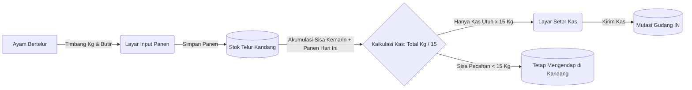

# Panduan Integrasi Mobile: Panen Telur (Kg) & Setor Kas ke Gudang (@ 15 Kg)

Dokumen ini ditujukan khusus bagi **Mobile Developer** untuk memandu implementasi UI/UX dan integrasi API pada fitur baru: **Pencatatan Panen di Kandang (satuan KG)** dan **Penyetoran ke Gudang (khusus KAS @ 15 KG)**.

---

## 1. Konsep & Aturan Bisnis Inti



### 3 Poin Aturan Penting untuk Mobile:
1. **Di Kandang**: Panen diinput murni dalam satuan **KG** (dan butir). Telur masuk ke persediaan kandang, **TIDAK** otomatis masuk ke gudang.
2. **Ke Gudang**: Telur dipindahkan ke gudang **HANYA KAS UTUH (@ 15 KG)**. Inputan setoran ke gudang hanya menerima angka bulat jumlah Kas (1, 2, 3 Kas, dst).
3. **Akumulasi Sisa Pecahan**: Sisa pecahan Kg ($< 15\text{ Kg}$) tetap berada di kandang dan akan otomatis ditambahkan ke panen hari berikutnya.

---

## 2. Rekomendasi Tampilan Layar (UI/UX Flow)

### Layar 1: Form Input Panen Harian (`/api/produksi-telur`)
- **Banner Informasi Atas**: Tampilkan badge/card: *"Sisa Telur Kemarin di Kandang: X Kg"*.
- **Input Field**:
  - Tanggal Panen (Default: Hari ini).
  - Telur Utuh: Input `Butir` dan `Kg` (misal: 800 Butir, 50.0 Kg).
  - Telur Rusak/Bentes (Opsional): Input `Butir` dan `Kg` (misal: 15 Butir, 1.0 Kg).
- **Live Preview Kalkulasi**:
  - Total di Kandang: $\text{Sisa Kemarin} + \text{Input Hari Ini}$
  - Potensi Siap Setor: $\lfloor \text{Total} / 15 \rfloor\text{ Kas}$
  - Sisa Mengendap: $\text{Total} \pmod{15}\text{ Kg}$
- **Tombol Aksi**: `[ Simpan Panen Kandang ]`

---

### Layar 2: Widget Dashboard / Kartu Saldo Kandang
- **Card Persediaan Telur Kandang**:
  - Saldo Saat Ini: `50.0 Kg`
  - Kas Siap Setor: `3 Kas (45.0 Kg)`
  - Sisa Mengendap: `5.0 Kg`
- **Tombol Shortcut**: `[ Setor Kas ke Gudang ]` (mengarah ke Layar 3).

---

### Layar 3: Form Setor Kas ke Gudang (`/api/setor-telur`)
- **Pilihan Gudang Tujuan**: Dropdown Gudang dikunci khusus **Gudang Pusat** (`GDG0001` - Gudang Pusat Telur). Mobile UI disarankan membuat dropdown ini langsung terpilih secara default atau berstatus read-only info, karena penyetoran telur dari kandang hanya diizinkan ke Gudang Pusat (gudang mobil sales ditolak oleh sistem).
- **List Telur yang Bisa Disetor**:
  - Nama Produk: *Telur Ayam Negeri (Utuh)*
  - Saldo Tersedia di Kandang: `50.0 Kg`
  - Rekomendasi Kas Maksimal: `3 Kas`
  - **Input Jumlah Kas**: Stepper / Counter (`[-] 3 [+] Kas`)
  - Info Real-time: *3 Kas = 45.0 Kg (Sisa 5.0 Kg tetap tinggal di kandang)*
- **Catatan**: Input teks catatan operasional (opsional).
- **Tombol Aksi**: `[ Konfirmasi & Setor Kas ke Gudang ]`

---

### Layar 4: Bukti / Detail Setoran (Surat Jalan Digital)
- No. Setor: `STR-TLR-KDG-001-20261014-001`
- Tanggal & Waktu: `14 Okt 2026, 08:30 WIB`
- Dari: `Kandang Flamboyan A` $\rightarrow$ Ke: `Gudang Pusat Telur`
- Total Disetor: `3 Kas (45.0 Kg)`
- Sisa Saldo di Kandang: `5.0 Kg`

---

## 3. Spesifikasi Kontrak API Lengkap

### Endpoint 1: Load Form Panen Telur
Memuat data inisial form panen kandang, termasuk sisa Kg kemarin.
- **Method**: `GET`
- **Endpoint**: `/api/produksi-telur/form?kdg_code={KDG_CODE}`
- **Headers**:
  ```http
  Authorization: Bearer {token}
  Accept: application/json
  ```
- **Contoh Response (200 OK)**:
```json
{
  "status": "success",
  "message": "Berhasil mengambil data form produksi",
  "data": {
    "prd_code": "PRD-KDG-001-202610-001",
    "kdg_code": "KDG-001",
    "populasi_ayam_saat_ini": 10500,
    "saldo_telur_kandang": [
      {
        "sku_product": "TLR-001",
        "sku_name": "Telur Ayam Negeri",
        "kategori": "Utuh",
        "saldo_kg": 5.0,
        "kas_tersedia": 0,
        "sisa_kg": 5.0,
        "conversion_rate": 15.0
      }
    ]
  }
}
```

---

### Endpoint 2: Submit Laporan Panen Telur (Satuan KG)
Mencatat hasil panen harian ke stok kandang. **Tidak mengurangi/menambah mutasi gudang.**
- **Method**: `POST`
- **Endpoint**: `/api/produksi-telur`
- **Headers**:
  ```http
  Authorization: Bearer {token}
  Content-Type: application/json
  Accept: application/json
  ```
- **Request Body (JSON)**:
```json
{
  "kdg_code": "KDG-001",
  "tanggal": "2026-10-14",
  "details": [
    {
      "sku_product": "TLR-001",
      "kategori": "Utuh",
      "qty_butir": 820,
      "qty_kg": 50.0
    },
    {
      "sku_product": "PRD-006",
      "kategori": "Rusak",
      "qty_butir": 10,
      "qty_kg": 0.8
    }
  ]
}
```
- **Contoh Response (201 Created)**:
```json
{
  "status": "success",
  "message": "Laporan panen telur berhasil disimpan di kandang. Telur tersimpan dalam satuan Kg dan siap disetor ke gudang dalam satuan Kas.",
  "produksi_code": "PRD-KDG-001-20261014-001",
  "stok_kandang_info": [
    {
      "sku_product": "TLR-001",
      "kategori": "Utuh",
      "panen_kg": 50.0,
      "qty_butir": 820.0,
      "saldo_sekarang_di_kandang_kg": 55.0,
      "potensi_setor_kas": 3,
      "sisa_kg_di_kandang": 10.0,
      "label": "Total di Kandang: 55 Kg = 3 Kas Siap Setor (Sisa 10 Kg mengendap di kandang)"
    }
  ]
}
```

---

### Endpoint 3: Cek Saldo Telur Kandang Real-time
Gunakan endpoint ini untuk me-refresh data persediaan telur kandang kapan saja (misal saat buka dashboard atau pull-to-refresh).
- **Method**: `GET`
- **Endpoint**: `/api/produksi-telur/saldo-kandang?kdg_code={KDG_CODE}`
- **Contoh Response (200 OK)**:
```json
{
  "status": "success",
  "message": "Saldo telur mengendap di kandang",
  "data": [
    {
      "sku_product": "TLR-001",
      "sku_name": "Telur Ayam Negeri",
      "kategori": "Utuh",
      "saldo_kg": 55.0,
      "kas_tersedia": 3,
      "sisa_kg": 10.0,
      "conversion_rate": 15.0
    }
  ]
}
```

---

### Endpoint 4: Load Form Setor Kas ke Gudang
Memuat daftar saldo kandang, jumlah Kas yang siap disetor, serta list gudang tujuan.
- **Method**: `GET`
- **Endpoint**: `/api/setor-telur/form?kdg_code={KDG_CODE}`
- **Contoh Response (200 OK)**:
```json
{
  "status": "success",
  "message": "Berhasil memuat form setor telur",
  "data": {
    "kandang": {
      "kdg_code": "0001",
      "kdg_nama": "Kandang 1"
    },
    "default_gudang_code": "GDG0001",
    "default_gudang_nama": "Gudang Pusat",
    "saldo_kandang": [
      {
        "sku_product": "1500123",
        "sku_name": "Telur Ayam Negeri",
        "kategori": "Utuh",
        "saldo_kg": 50.0,
        "kas_tersedia": 3,
        "sisa_kg": 5.0,
        "conversion_rate": 15.0
      }
    ],
    "daftar_gudang": [
      {
        "gudang_code": "GDG0001",
        "gudang_nama": "Gudang Pusat",
        "gudang_tipe": "Gudang Pusat"
      }
    ]
  }
}
```
*(Catatan: `daftar_gudang` diisi HANYA oleh Gudang Pusat `GDG0001` secara otomatis).*

---

### Endpoint 5: Submit Setor Kas ke Gudang (Khusus Kas @ 15 Kg)
Mengirim Kas utuh ke gudang. Saldo kandang dipotong sebesar ($\text{Kas} \times 15\text{ Kg}$) dan stok gudang bertambah.
- **Method**: `POST`
- **Endpoint**: `/api/setor-telur`
- **Request Body (JSON)**:
```json
{
  "kdg_code": "0001",
  "gudang_code": "GDG0001",
  "tanggal": "2026-10-14",
  "catatan": "Setor hasil panen pagi",
  "items": [
    {
      "sku_product": "1500123",
      "kategori": "Utuh",
      "qty_kas": 3,
      "catatan": "3 Kas utuh @ 15 Kg"
    }
  ]
}
```
*(Tip Kompatibilitas: Backend memiliki auto-normalizer yang mendukung kode alias seperti `KDG-001`, `GDG-001`, `TLR-001`. Namun gudang tujuan haruslah Gudang Pusat).*
- **Contoh Response (201 Created)**:
```json
{
  "status": "success",
  "message": "Setoran kas telur berhasil diproses. Stok gudang bertambah sebesar jumlah kas utuh, sisa Kg tetap mengendap di kandang.",
  "data": {
    "setor_code": "STR-TLR-KDG-001-20261014-001",
    "kdg_code": "KDG-001",
    "gudang_code": "GDG-001",
    "tanggal_setor": "2026-10-14",
    "total_kas": 3,
    "total_kg_ekuivalen": 45.0,
    "details": [
      {
        "sku_product": "TLR-001",
        "kategori": "Utuh",
        "qty_kas": 3,
        "qty_kg_ekuivalen": 45.0,
        "sisa_kg_di_kandang": 5.0
      }
    ]
  }
}
```

---

### Endpoint 6: Riwayat Setoran Kas Telur
- **Method**: `GET`
- **Endpoint**: `/api/setor-telur?kdg_code=KDG-001&start_date=2026-10-01&end_date=2026-10-31`
- **Response (200 OK)**: Pagination list data transaksi setoran kas telur.

---

### Endpoint 7: Detail Bukti Setoran Kas Telur
- **Method**: `GET`
- **Endpoint**: `/api/setor-telur/{setor_code}`
- **Contoh**: `/api/setor-telur/STR-TLR-KDG-001-20261014-001`
- **Response (200 OK)**: Detail lengkap satu dokumen setoran (header + details produk, nama petugas, total kas, sisa di kandang).

---

## 4. Penanganan Kasus Khusus & Error Handling di Mobile

| Kondisi / Kasus | Respon HTTP | Pesan Error | Solusi di UI Mobile |
| :--- | :---: | :--- | :--- |
| **Setor Kas Melebihi Saldo** | `400 Bad Request` | *"Saldo telur Utuh (TLR-001) di kandang KDG-001 tidak mencukupi. Dibutuhkan 60 Kg untuk 4 Kas, namun saldo di kandang hanya tersisa 50 Kg."* | Berikan validasi sisi client: batasi counter/stepper Kas maksimal sebesar `kas_tersedia`. |
| **Jumlah Kas = 0** | `400 Bad Request` | *"Jumlah kas yang disetor harus lebih dari 0."* | Disable tombol setor jika nilai kas adalah 0. |
| **Belum Absen Masuk** | `403 Forbidden` | *"Unauthorized. Harap lakukan Absen Masuk terlebih dahulu."* | Tampilkan popup: *"Anda belum Absen Masuk hari ini"*, arahkan tombol langsung ke Layar Absensi. |
| **Kandang Tidak Ada Siklus Aktif** | `400 Bad Request` | *"Tidak ada periode aktif untuk kandang ini. Silakan mulai siklus terlebih dahulu."* | Tampilkan banner peringatan bahwa periode kandang belum diaktifkan oleh Admin. |

---

## 5. Ringkasan Sinkronisasi Data (Cheat Sheet)

```dart
// Contoh Logika di Flutter / Mobile App:
double sisaKemarin = formResponse.data.saldoTelurKandang.first.saldoKg; // 5.0 Kg
double inputPanenHariIni = double.parse(controllerPanenKg.text);        // 50.0 Kg

double totalDiKandang = sisaKemarin + inputPanenHariIni;               // 55.0 Kg
int kasSiapSetor = (totalDiKandang / 15).floor();                       // 3 Kas
double sisaTinggalDiKandang = totalDiKandang - (kasSiapSetor * 15);      // 10.0 Kg
```
